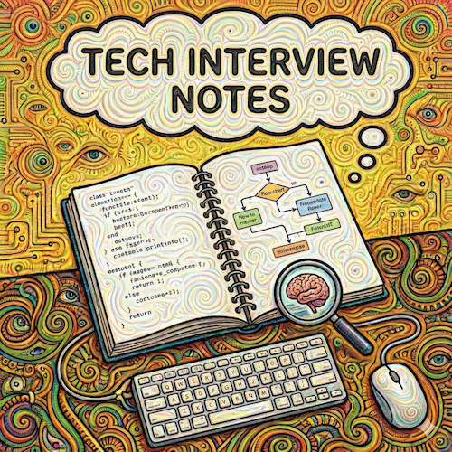

# Interview Prep

**Technical interview preparation notes and cheat sheets**

## Topics

- [System Design Framework](notes/system_design.md)
- [System Capacity & Scale](notes/system_capacity.md)
- [System High Availability](notes/system_high_availability.md)
- [Data Store Selection & Scaling](notes/data_store_selection.md)
- [RDBMS Internals](notes/rdbms_internals.md)
- [SQL Interview Prep](notes/sql_interview.md)
- [Docker](notes/docker.md)
- [Kubernetes](notes/k8s.md)
- [Message Queues](notes/message_queues.md)
- [Kafka](notes/kafka.md)
- [Caching](notes/cache.md)
- [Redis](notes/redis.md)
- [JVM](notes/jvm.md)
- [Methodologies](notes/methodologies.md)
- [RFC](notes/rfc.md)
